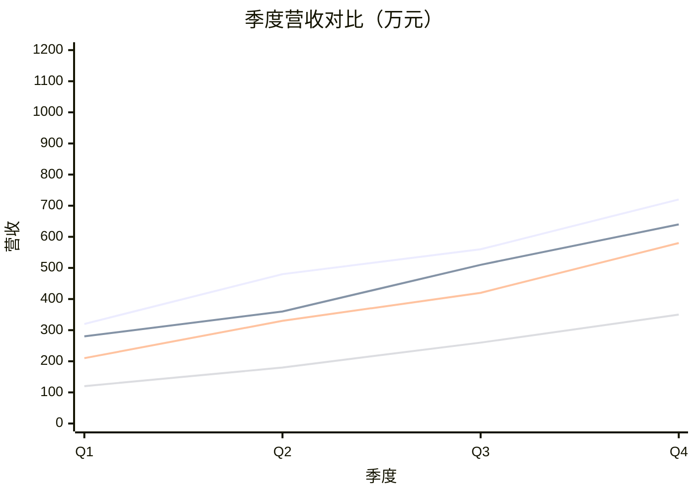
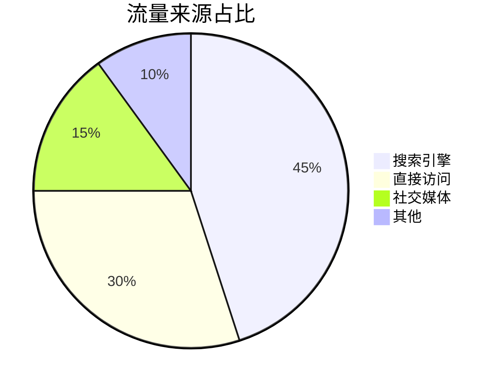

# 图表示例（Markdown + Mermaid）

本文用 Mermaid 代码块描述图表，在应用内预览时会自动渲染。

## 复杂折线图（一个图 4 条折线）

两个图用 ` ```mermaid row ` 标记，会并排在同一行展示：



```mermaid row
xychart-beta
  title "月度订单量（柱状）"
  x-axis "月份" [1月, 2月, 3月, 4月, 5月, 6月]
  y-axis "订单量" 0 --> 1600
  bar "线上" [820, 932, 901, 934, 1290, 1330]
  bar "线下" [620, 732, 701, 734, 1090, 1130]
```

## 饼图



## 使用步骤

1. 用 ` ```mermaid ` 代码块写图表。
2. 在 `xychart-beta` 里写多条 `line` 或 `bar`，同一个图就会叠出多条线/柱。
3. 想并排展示多个图时，把语言标记改成 ` ```mermaid row `。
4. 给系列加名称：`line "名称" [...]`，图例会显示对应名称。
5. 静态网站页面现在也会加载 ECharts，和应用内预览使用同一套图表渲染。

## 说明

- 折线图用 `xychart-beta` 的 `line [...]`，柱状图则换成 `bar [...]`；同一图内写多条即叠在一起。
- 想给每条线/柱起名字，写成 `line "名称" [...]` / `bar "名称" [...]`，图例会显示该名称。
- 饼图用 `pie title ...`，每行 `"名称" : 数值`，数值按比例自动换算。
- 独立静态页面（非应用内预览）未加载 Mermaid 脚本，届时会显示源码。
