# 超长从左到右流程：拆成两行多个子图

整体分两行：第一行蓝色（P1~P4：校验 → 监控），第二行红色（P5~P9：同步 → 收尾）。两行各自从左到右横向排列，两个子图内部也从左到右，行与行之间用折线连接。

```mermaid
flowchart TB
  subgraph ROW1["第一行（蓝色）：校验 → 监控"]
    direction LR
    subgraph P1["第一段：校验与处理（从左到右）"]
      direction LR
      A[开始] --> B[校验参数] --> C[读取数据] --> D[处理数据]
    end

    subgraph P2["第二段：落库与收尾（从左到右）"]
      direction LR
      E[写入结果] --> F[发送通知] --> G[记录日志] --> H[结束主流程]
    end

    subgraph P3["第三段：异步归档（从左到右）"]
      direction LR
      I[生成归档包] --> J[上传存储] --> K[标记归档完成]
    end

    subgraph P4["第四段：监控与告警（从左到右）"]
      direction LR
      L[采集运行指标] --> M{是否异常}
      M -->|是| N[触发告警]
      M -->|否| O[写入监控面板]
      N --> P[汇总监控结果]
      O --> P
    end

    D --> E
    H --> I
    K --> L
  end

  subgraph ROW2["第二行（红色）：同步 → 收尾"]
    direction LR
    subgraph P5["第五段：数据同步（从左到右）"]
      direction LR
      Q[拉取增量] --> R[合并冲突] --> S[提交同步]
    end

    subgraph P6["第六段：报表生成（从左到右）"]
      direction LR
      T[汇总数据] --> U[渲染报表] --> V[导出文件]
    end

    subgraph P7["第七段：审批流（从左到右）"]
      direction LR
      W[提交审批] --> X{审批通过}
      X -->|是| Y[执行变更]
      X -->|否| Z[退回修改]
      Y --> AA[归档审批]
      Z --> AA
    end

    subgraph P8["第八段：发布部署（从左到右）"]
      direction LR
      AB[构建镜像] --> AC[灰度发布] --> AD[全量上线]
    end

    subgraph P9["第九段：收尾统计（从左到右）"]
      direction LR
      AE[统计耗时] --> AF[生成报告] --> AG[流程结束]
    end

    S --> T
    V --> W
    AA --> AB
    AD --> AE
  end

  ROW1 --> ROW2

  classDef blueFill fill:#d6e4ff,stroke:#1e63d0,color:#0b3d91
  class A,B,C,D,E,F,G,H,I,J,K,L,M,N,O,P blueFill
  style P1 fill:#f0f6ff,stroke:#1e63d0
  style P2 fill:#f0f6ff,stroke:#1e63d0
  style P3 fill:#f0f6ff,stroke:#1e63d0
  style P4 fill:#f0f6ff,stroke:#1e63d0

  classDef redFill fill:#ffd6d6,stroke:#d32f2f,color:#8b0000
  class Q,R,S,T,U,V,W,X,Y,Z,AA,AB,AC,AD,AE,AF,AG redFill
  style P5 fill:#fff0f0,stroke:#d32f2f
  style P6 fill:#fff0f0,stroke:#d32f2f
  style P7 fill:#fff0f0,stroke:#d32f2f
  style P8 fill:#fff0f0,stroke:#d32f2f
  style P9 fill:#fff0f0,stroke:#d32f2f
```

说明：

- 外层 `flowchart TB` 让两行上下排列；`ROW1`/`ROW2` 两个行容器的 `direction LR` 让各自子图左右并排。
- 子图内部从左到右由所在行容器的 `direction LR` 保证；Mermaid 对「有节点连到子图外部」的子图会忽略它自己的 `direction`，所以内层 `direction LR` 只是声明意图，真正生效的是行容器。
- 每行内部子图之间的连接只用一条边，渲染器会自动生成跨子图的折线：`D --> E`、`H --> I`、`K --> L`、`S --> T`、`V --> W`、`AA --> AB`、`AD --> AE`。
- 两行之间用子图级连接 `ROW1 --> ROW2` 画折线；不要用 `P --> Q` 这类跨行节点边，否则 Mermaid 会忽略行容器的 `direction LR`，把子图竖排。
- 第一行用 `classDef blueFill` 染蓝，第二行用 `classDef redFill` 染红，行容器用 `style` 区分底色。
- 文字大小由渲染器按图宽自适应（行数变少、图变窄，预览里字号会显得更大），本文件没有单独设置字号。
