# 复杂流程图：带环形回边（循环）的发布流水线

一张包含多条「环形回边」的复杂流程图：需求评审、开发自测、评审、测试、灰度，任一环节失败都会沿环形边回到上游重来，全部通过才进入发布与复盘。

```mermaid
flowchart TD
  Start([开始]) --> Req[需求收集]
  Req --> Review{需求评审通过?}
  Review -->|否| Req
  Review -->|是| Design[方案设计]
  Design --> DesignReview{设计评审通过?}
  DesignReview -->|否| Design
  DesignReview -->|是| Dev[编码实现]

  subgraph DEV_LOOP["开发内环：编码 → 自测 → 优化"]
    direction TB
    Dev --> UnitTest[单元测试]
    UnitTest --> SelfCheck{自测通过?}
    SelfCheck -->|否| Fix[修复缺陷]
    Fix --> Dev
    SelfCheck -->|是| Optimize[代码优化]
    Optimize --> UnitTest
  end

  Optimize --> CR[CodeReview]
  CR --> CRPass{评审通过?}
  CRPass -->|否| FixCR[按意见修改]
  FixCR --> Dev
  CRPass -->|是| CI[触发 CI 构建]

  subgraph QA_LOOP["测试外环：集成测试 → 回归"]
    direction TB
    CI --> BuildOK{构建成功?}
    BuildOK -->|否| Dev
    BuildOK -->|是| IT[集成测试]
    IT --> ITPass{集成测试通过?}
    ITPass -->|否| BugFix[定位并修复]
    BugFix --> IT
    ITPass -->|是| Regression[回归测试]
    Regression --> RegPass{回归通过?}
    RegPass -->|否| BugFix
  end

  RegPass -->|是| Gray[灰度发布]
  Gray --> Monitor{监控指标正常?}
  Monitor -->|否| Rollback[回滚版本]
  Rollback --> Dev
  Monitor -->|是| Canary{灰度比例达标?}
  Canary -->|否| Expand[扩大灰度]
  Expand --> Gray
  Canary -->|是| Release[全量发布]
  Release --> Retro[复盘总结]
  Retro --> End([结束])

  classDef startEnd fill:#0f2a4d,stroke:#3b82f6,color:#e5edff,stroke-width:2px
  classDef normal fill:#0f2a4d,stroke:#3b82f6,color:#e5edff
  classDef decision fill:#3b2f0b,stroke:#f59e0b,color:#ffe8b3
  classDef hot fill:#0b3b4a,stroke:#22d3ee,color:#e5edff
  classDef danger fill:#3a1d1d,stroke:#e5484d,color:#ffe5e5

  class Start,End startEnd
  class Req,Design,Dev,Optimize,CR,CI,IT,Regression,Gray,Expand,Release,Retro,UnitTest normal
  class Review,DesignReview,SelfCheck,CRPass,BuildOK,ITPass,RegPass,Monitor,Canary decision
  class Fix,FixCR,BugFix,Rollback danger
  class SelfCheck hot

  style DEV_LOOP fill:#0d1b2a,stroke:#22d3ee,stroke-dasharray:5 5
  style QA_LOOP fill:#0d1b2a,stroke:#f59e0b,stroke-dasharray:5 5
```

## 环形（回边）说明

- **需求内环**：`Review --否--> Req`，评审不通过直接回到需求收集。
- **设计内环**：`DesignReview --否--> Design`，设计不通过回到方案设计。
- **开发内环**（`DEV_LOOP`）：`SelfCheck --否--> Fix --> Dev`，自测失败经修复回到编码；`Optimize --> UnitTest` 让优化后重新自测，形成闭合环。
- **评审回边**：`CRPass --否--> FixCR --> Dev`，评审意见回到编码。
- **测试外环**（`QA_LOOP`）：`BuildOK --否--> Dev`、`ITPass --否--> BugFix --> IT`、`RegPass --否--> BugFix`，任一步失败都回到对应上游。
- **发布回边**：`Monitor --否--> Rollback --> Dev`（回滚后重新开发），`Canary --否--> Expand --> Gray`（比例不足就扩大灰度再监控）。

> 说明：Mermaid 对回边（指向上游的箭头）会自动绕行绘制；节点较多时可用 `flowchart LR` 改成横向布局，或把 `direction` 从 `TB` 改为 `LR` 让环形更紧凑。
