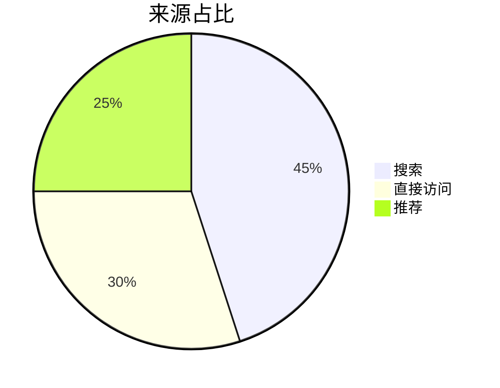

# 折线图 + 饼图并排

```mermaid row
xychart-beta
    title "访问趋势"
    x-axis "月份" [1月, 2月, 3月, 4月, 5月]
    y-axis "访问量" 0 --> 120
    line [20, 45, 60, 85, 110]
```



## 基础表格

| 项目 | 数值 | 说明 |
| --- | ---: | --- |
| 访问量 | 1,234 | 本月累计 |
| 转化率 | 12.5% | 较上月增长 |
| 平均停留 | 3m 42s | 移动端为主 |

## 对齐方式

| 左对齐 | 居中 | 右对齐 |
| :--- | :---: | ---: |
| alpha | beta | 100 |
| gamma | delta | 200 |
| epsilon | zeta | 300 |

## 宽表格（多列）

| 日期 | 访问量 | 访客数 | 转化数 | 转化率 | 客单价 | 成交额 | 环比 | 备注 |
| --- | ---: | ---: | ---: | ---: | ---: | ---: | ---: | --- |
| 2026-10-01 | 1200 | 860 | 72 | 8.4% | 128.00 | 9216 | +2.1% | 国庆预热 |
| 2026-10-02 | 1350 | 910 | 81 | 8.9% | 131.50 | 10651 | +15.6% | 活动上线 |
| 2026-10-03 | 1420 | 980 | 88 | 9.0% | 129.90 | 11431 | +7.3% | 稳定增长 |
| 2026-10-04 | 1380 | 940 | 79 | 8.4% | 127.20 | 10049 | -12.1% | 节中回落 |

## 行内格式

| 类型 | 示例 | 说明 |
| --- | --- | --- |
| 行内代码 | `npm run dev` | 启动开发环境 |
| 链接 | [Gitee](https://gitee.com/slxxzh12/vscode-ai/releases) | 发布页 |
| 加粗/斜体 | **重要** / *提示* | 混排效果 |
| 转义竖线 | a \| b | 单元格内竖线 |

## 长文本与换行

| 场景 | 描述 |
| --- | --- |
| 超长文本 | 这是一段很长的说明文字，用于检查表格单元格在窄屏下是否会自动换行，且不会把整个页面撑出横向滚动条。 |
| 多行内容 | 第一行<br>第二行<br>第三行 |
| 空单元格 |  |
| 纯符号 | — / N/A / ? |

## 重复行与边界

| 名称 | 值 |
| --- | --- |
| 相同 | 1 |
| 相同 | 1 |
| 相同 | 1 |
| 0 | 0 |
| 空 |  |
