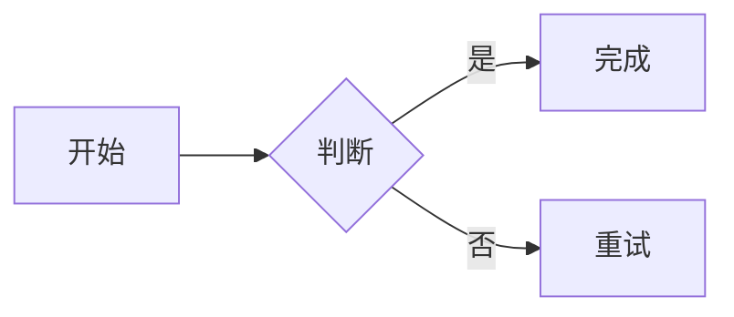
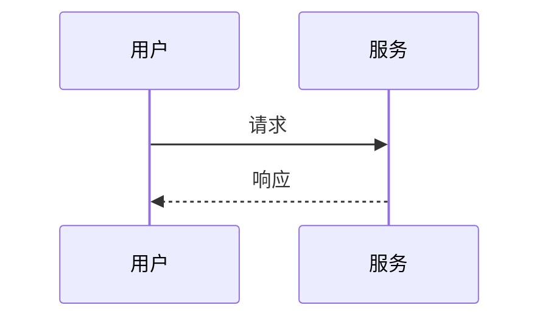

# Mermaid 并排 + 表格筛选示例

两个图都用 ` ```mermaid row ` 标记，渲染时会自动放在同一行（窄屏自动换行）：





## 表格

下面的表格会自动用 Element Plus 渲染，支持表头排序、筛选和斑马纹：

| 名称 | 类型 | 数量 | 状态 |
| --- | --- | --- | --- |
| Alpha | 服务 | 12 | 启用 |
| Beta | 任务 | 3 | 停用 |
| Gamma | 服务 | 28 | 启用 |
| Delta | 脚本 | 7 | 启用 |
| Epsilon | 任务 | 3 | 停用 |
