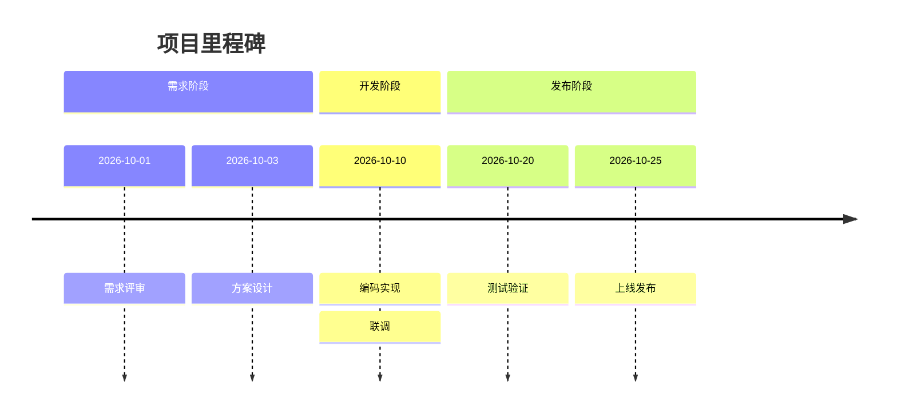
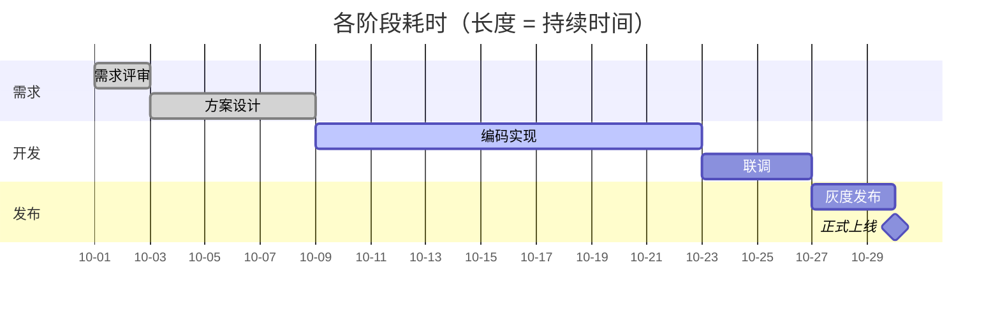
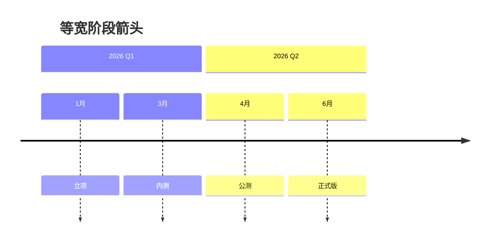

# 时间轴示例（Mermaid timeline）

本文用 Mermaid 的 `timeline` 语法描述项目阶段；应用内预览和静态网站会把它渲染成 ECharts 时间轴。

## 项目里程碑



## 版本节奏


## 各阶段耗时（Gantt：条越长表示占时越久）

`timeline` 只能表示时间点；要表达「某段占的时间长、某段短」，用 `gantt`，条形长度按真实时长比例绘制。



关键点：
- `2d` / `6d` / `14d` 就是该阶段的持续时间，条越长表示越久。
- `after a1` 表示紧接上一个任务，适合阶段串行。
- `done` / `active` / `crit` 会显示不同颜色，`milestone` 显示成菱形。

## PPT 风格箭头时间轴（Gantt chevron）

在 `gantt` 后面加 `chevron`，就会把阶段画成首尾相接的箭头块；块宽仍然按持续时间比例。

```mermaid
gantt chevron
  title 项目阶段（箭头时间轴）
  dateFormat YYYY-MM-DD
  section 需求
  需求评审 :done, a1, 2026-10-01, 2d
  方案设计 :done, a2, after a1, 6d
  section 开发
  编码实现 :active, a3, after a2, 14d
  联调     :a4, after a3, 4d
  section 发布
  灰度发布 :a5, after a4, 3d
  正式上线 :milestone, m1, after a5, 0d
```

如果只是想要等宽的阶段箭头（不按时间比例），用 `timeline chevron`：



## 写法说明

1. 第一行写 `timeline`，第二行可写 `title`。
2. `section` 用来给时间段分组，例如「需求阶段」「开发阶段」。
3. 每个时间点写成 `时间 : 事件`，例如 `2026-10-01 : 需求评审`。
4. 同一时间点有多个事件时，可以另起一行用 `: 事件` 续写，例如上面的「联调」。
5. 要表示各阶段长短，改用 `gantt` 并写 `开始, 持续时间`。
