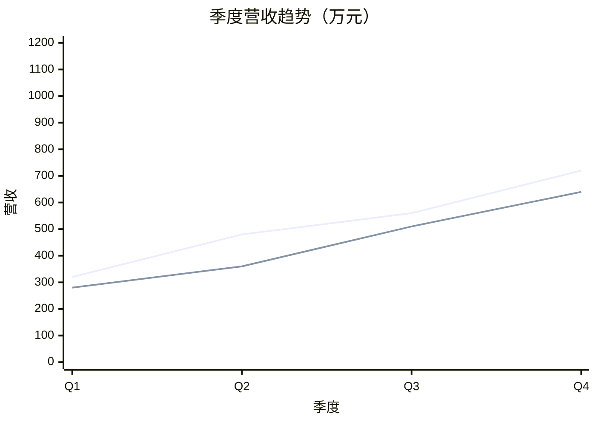
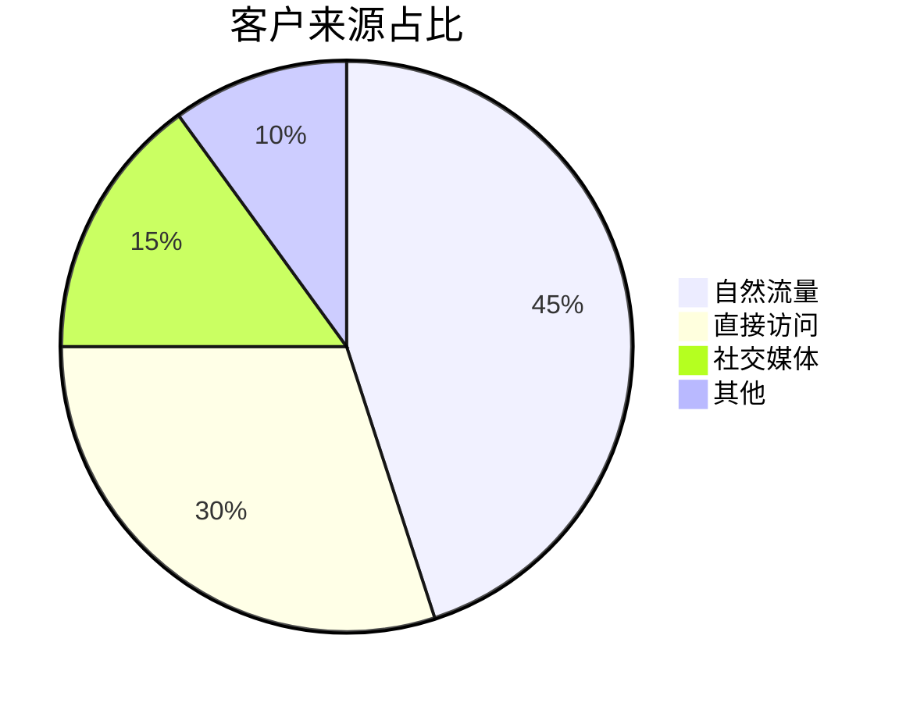
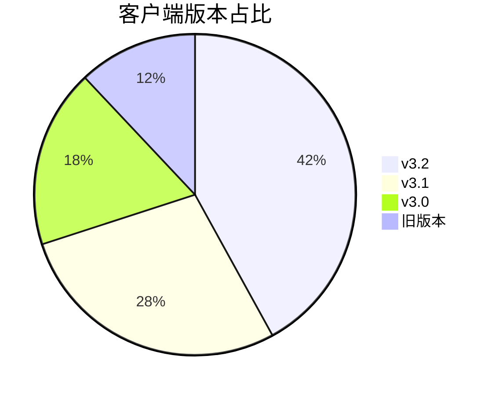
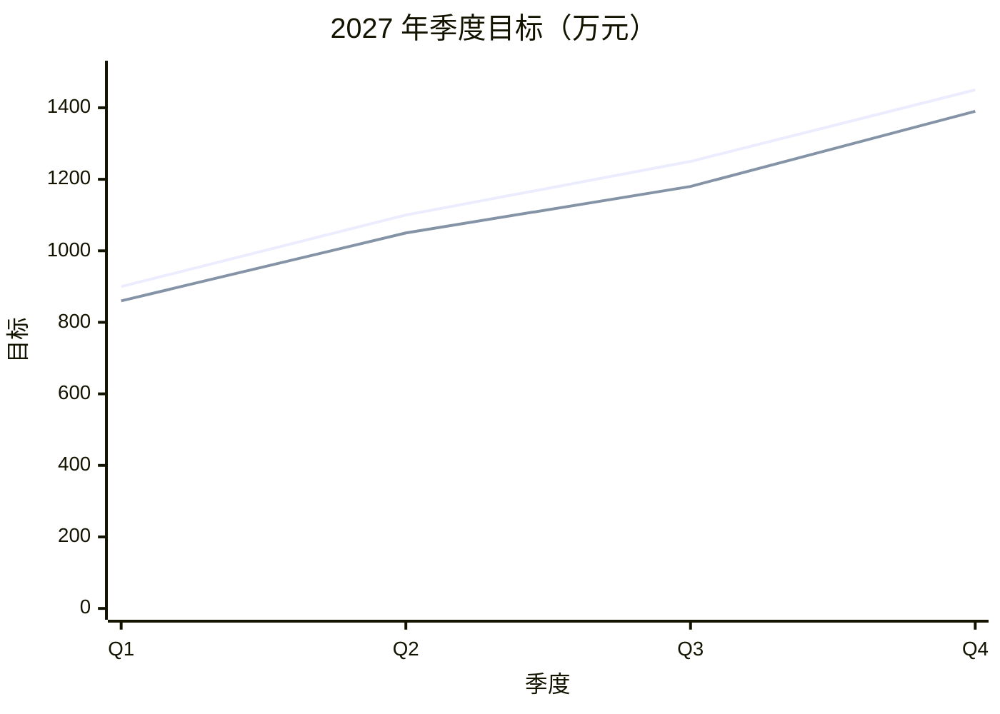
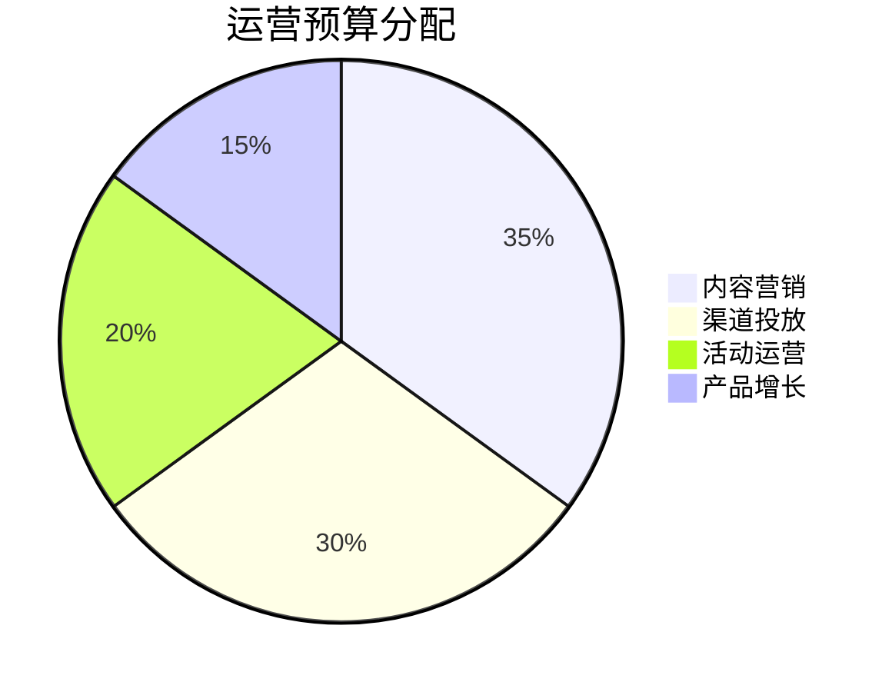

# 演讲人介绍

## 用户 / 演讲人说明

| 项目 | 内容 |
| --- | --- |
| 姓名 | 张三 |
| 职位 | 数据分析负责人 |
| 主题 | 2026 年业务数据与运营计划 |
| 日期 | 2026-11-03 |
| 联系方式 | zhangsan@example.com |

本次分享分为市场概览、产品数据和运营计划三个部分，每个部分包含趋势折线图、占比饼图和明细表格。

# 目录

| 章节 | 内容 | 页码 |
| --- | --- | ---: |
| 01 | 市场概览：规模、趋势与来源占比 | 3 |
| 02 | 产品数据：活跃、留存与版本分布 | 4 |
| 03 | 运营计划：目标、节奏与资源投入 | 5 |

# 01 市场概览

## 趋势：季度营收



## 来源占比



## 市场概览明细

| 指标 | 数值 | 同比 | 说明 |
| --- | ---: | ---: | --- |
| 市场规模 | 1,280 万 | +18.6% | 全年累计 |
| 新增客户 | 3,420 | +12.4% | 去重后 |
| 客单价 | 3,740 元 | +5.1% | 平均订单金额 |
| 复购率 | 28.5% | +2.3pp | 90 天内复购 |

# 02 产品数据

## 趋势：月活跃用户

```mermaid
xychart-beta
  title "月活跃用户趋势（万人）"
  x-axis "月份" [7月, 8月, 9月, 10月, 11月, 12月]
  y-axis "活跃用户" 0 --> 160
  line "App" [82, 93, 101, 118, 126, 135]
  line "Web" [62, 73, 70, 79, 88, 96]
```

## 版本分布



## 产品数据明细

| 指标 | 数值 | 环比 | 说明 |
| --- | ---: | ---: | --- |
| App 活跃 | 135 万 | +7.1% | 12 月 |
| Web 活跃 | 96 万 | +9.1% | 12 月 |
| 次日留存 | 41.2% | +1.8pp | 新用户 |
| 7 日留存 | 24.6% | +0.9pp | 新用户 |
| 崩溃率 | 0.18% | -0.04pp | 全端 |

# 03 运营计划

## 趋势：目标与进度



## 预算分配



## 运营计划明细

| 季度 | 目标（万元） | 预测（万元） | 完成率 | 重点动作 |
| --- | ---: | ---: | ---: | --- |
| Q1 | 900 | 860 | 95.6% | 新品冷启动 |
| Q2 | 1,100 | 1,050 | 95.5% | 渠道扩量 |
| Q3 | 1,250 | 1,180 | 94.4% | 活动转化 |
| Q4 | 1,450 | 1,390 | 95.9% | 年度冲刺 |

---

说明：本文件按 `#` 一级标题分页，每个业务页包含折线图、饼图和表格；可直接用 PPT 预览/导出查看多页效果。
