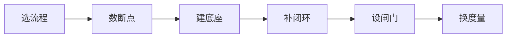

# Manus-AI-Native 构建开发工作流的理念洞察报告

## 一页结论

<!-- df-table width=100% -->

| 项目 | 内容 |
| --- | --- |
| 目标 | Session 从“个人对话框”变成“一项工作的协作单位” |
| 判断 | 组织效率看**上下文换手次数**，不看人多强 |
| 动作 | 选流程 → 数断点 → 建底座 → 补闭环 → 设闸门 → 换度量 |

# 1 三个重点

## 1.1 协作单位变了

<!-- df-table width=100% -->

| | 旧 | 新 |
|---|---|---|
| Session 边界 | 一个人的注意力 | **一项工作的边界** |
| 里面有什么 | 一个人 + 一个 AI | 多角色 + 多 Agent + 共享上下文 |
| 信息怎么走 | 找人、交接、开会 | 放在同一处，多方接着做 |

判断标准：**别人能不能进入这个 Session 接着干？** 能，才叫协作单位。

## 1.2 信息流从“人传人”变成“上下文共享”

<table style="width:100%">
  <thead>
    <tr>
      <th>旧链路</th>
      <th>新链路</th>
    </tr>
  </thead>
  <tbody>
    <tr>
      <td><pre class="mermaid">flowchart LR
  A[需求方] --> B[产品] --> C[设计] --> D[研发] --> E[联调] --> F[测试]
</pre></td>
      <td><pre class="mermaid">flowchart LR
  A[需求原文] --> S[Session]
  S --> B[产品]
  S --> C[研发]
  S --> D[测试]
</pre></td>
    </tr>
  </tbody>
</table>

减少信息损耗，最有效的不是把文档写清楚，而是让下游直接接触原始信息。

## 1.3 人从 in the loop 变成 on the loop

<!-- df-table width=100% -->

| | 从前 | 现在 |
|---|---|---|
| 人的位置 | in the loop | on the loop |
| 主要动作 | 补 AI 剩下的 | 设计规则、监督、判断 |
| 责任 | 完成任务 | 对结果负责 |

人的四项不可替代：**定义问题、供给上下文、判断质量、承担结果。**

# 2 断点与短板

## 2.1 五个断点

<!-- df-table width=100% -->

| # | 断点 | 典型表现 | 代价 |
|---|---|---|---|
| 1 | **需求转译断点** | 需求靠文档/口头转述，层层走样 | 返工、做错方向 |
| 2 | **交接断点** | 做完交给下一个人，对方不一定马上接 | 等待、上下文重建 |
| 3 | **查询断点** | 想知道某件事，先打听归谁管 | 打断成本、信息垄断 |
| 4 | **系统搬运断点** | 合同签了去改表格，内容发了再通知人 | 人力耗在搬运上 |
| 5 | **决策断点** | 决策者泡在群聊、仓库、会议里找“该定什么” | 注意力被稀释 |

## 2.2 六层短板

<!-- df-table width=100% -->

| 短板 | 我们的表现 | Manus 怎么解 |
|---|---|---|
| **上下文短板** | 知识在人脑和散落文档里，AI 消费不了 | 统一入口 + 给 AI 看的说明书 + 业务知识补齐 |
| **闭环短板** | 本地跑不起来、线上看不见、发布靠人 | 本地秒级验证 + 读线上日志 + AI 走发布（审批留人） |
| **权限短板** | 不敢让 AI 读线上、动代码、发版 | 分级权限 + 关键模块规则 + 最强模型审核 |
| **组织短板** | 岗位边界硬、Session 私有、审批链长 | 淡化岗位边界、Session 默认可见、关键节点才审批 |
| **度量短板** | 还在用人天/产出/故事点 | 改用换手次数、打断次数、闭环时长 |
| **文化短板** | 容忍低效、容错不足 | 对低效零容忍 + 探索 AI 边界 + 扁平扩散 |

## 2.3 结论

断点是表象，短板是根因。只上工具不补短板，Session 仍然只是更快的个人工具。

# 3 怎么做：一条路径，三个阶段

## 3.1 六步路径

## 3.2 三个阶段

<!-- df-table width=100% -->

| 阶段 | 重点动作 | 产出 | 度量 |
|---|---|---|---|
| 阶段一 0–3 月 | 选长流程、建说明书、需求原文进 Session | 信息流图、知识底座 v1、试点流水线 | 换手点、返工率 |
| 阶段二 3–12 月 | 本地验证、线上观测、AI 审核 + 人工终审 | 一键环境、质量闸门、PRV 模板 | 验证时长、定位时长、故障数 |
| 阶段三 12 月+ | 多人多 Agent、事件触发、数字同事 | 协作层、事件驱动、Agent 节点 | 可见覆盖率、搬运环节数 |

## 3.3 顺序不能反

**选流程 → 数断点 → 建底座 → 补闭环 → 设闸门 → 换度量**

# 4 度量：用四个数代替人天

## 4.1 四个核心指标

<!-- df-table width=100% -->

| 指标 | 定义 | 为什么重要 |
|---|---|---|
| **上下文换手次数** | 一项需求经过多少次“换人/换上下文” | 直接对应损耗 |
| **临时打断次数** | 每人每天因“找人问”被打断的次数 | 对应注意力成本 |
| **Session 可见覆盖率** | 同项目成员能看到彼此进度的比例 | 对应信息黑箱 |
| **端到端闭环时长** | 从需求进 Session 到验证通过 | 对应真实交付速度 |

## 4.2 辅助指标

- 因理解不一致导致的返工率。

# 5 收尾：留什么、略什么

## 5.1 值得细读

- Mono 的五个演进阶段：基础设施是一步步长出来的。
- 产品经理端到端上线 + 视频 PRV：需求表达带宽的升级。
- 数字同事的四个行为：Agent 如何成为信息流节点。
- Human on the loop：人的角色定位。

## 5.2 可以略读

- 具体人物故事与团队氛围描写。
- 人均 1 万美元的争论：是 Manus 的战略选择，不是普适标准。
- 文末的产品机会猜测：属于 Manus 自己的路线图。

## 5.3 带走三句话

- **目标**：Session 从个人对话框，变成一项工作的协作单位
- **判断**：组织效率看上下文换手次数，不看人多强
- **动作**：选流程 → 数断点 → 建底座 → 补闭环 → 设闸门 → 换度量

## 5.4 最后一句

> **不要问“我们该用哪个 AI 工具”，要问“我们的信息在哪儿换手，换手能不能被一个 Session 接住”。**
>
> 每消灭一次换手，组织就快一截；短板不补，工具再好也只是个人加速器。

---

## 鸣谢

本报告的观点与案例均来自以下原文，特此致谢：

- **《用 Manus 改造 Manus，AI Native 组织改造的实践和思考》**
- 作者：hidecloud
- 来源：微信公众号「潜云思绪」
- 原文地址：https://mp.weixin.qq.com/s/I_hNNAf7LFBf5nJ0rEJHig

感谢原作者对 Manus 内部 AI Native 实践的公开分享，为本报告提供了全部一手素材。报告中的分析与引申仅代表本报告观点，不代表原作者及 Manus 官方立场。
