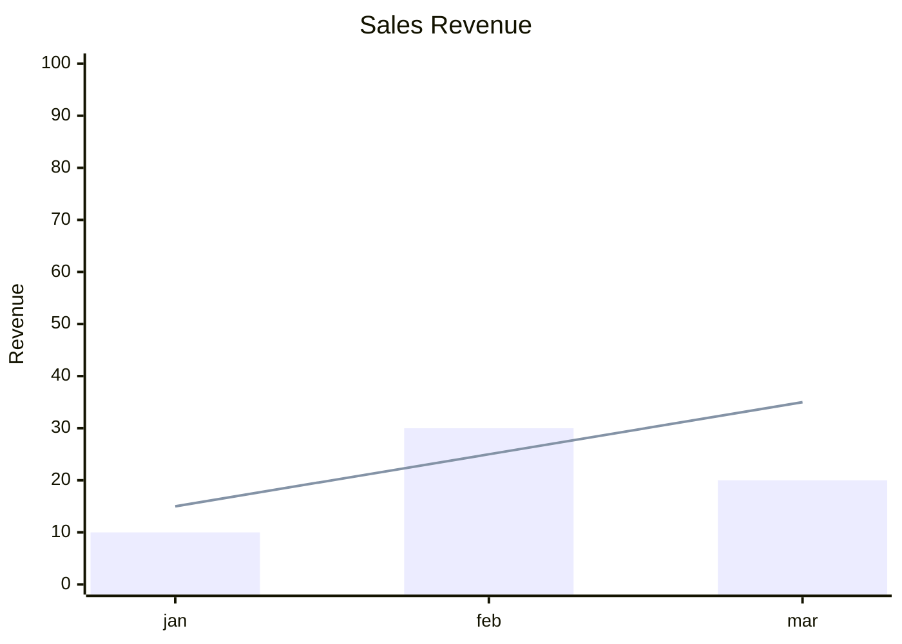
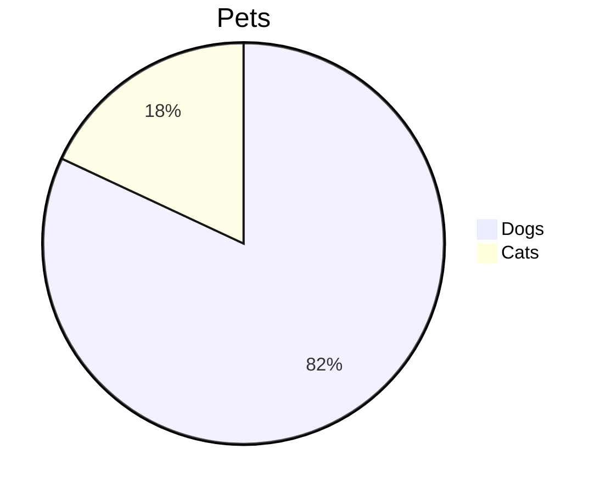

# Markdown 图表与表格增强设计（ECharts + Element Plus）

## 背景

当前 Markdown 里的 Mermaid 图由 `web/src/markdown.ts` 的 `renderMermaid` 直接渲染成 SVG，默认样式偏朴素；表格也是原生 `<table>`，观感与应用内 Element Plus 组件不一致。

目标是在不改动 `shared/markdown.js` 与服务端 Markdown 静态页的前提下，只增强前端 Markdown 展示：

- Mermaid 中适合 ECharts 的图表类型改用 ECharts 渲染，其余类型继续走 Mermaid；
- 所有 Markdown 展示位置的表格改用 Element Plus 的 `<el-table>` 渲染。

## 范围

### 支持

- Mermaid `xychart-beta`（折线 `line` / 柱状 `bar`，可混合）
- Mermaid `pie`
- 简单 Markdown 表格（无合并单元格、无嵌套表格）
- 前端所有 Markdown 展示位置：
  - `DocViewer.vue` 文件预览
  - `AppMarketView.vue` 公告
  - `JobsView.vue` 任务报告
  - `SchedulerReportView.vue` 报告
  - `SchedulerView.vue` 聊天报告
  - `WorkflowFilesTab.vue` 文件预览

### 不支持 / 不做

- 其他 Mermaid 图类型（flowchart、sequence、class、state、ER、gantt、timeline、git 等）继续由 Mermaid 渲染，不做 ECharts 映射
- 复杂表格（`rowspan` / `colspan`、嵌套表格）保持原生渲染
- 不修改 `shared/markdown.js`，服务端 `server/markdown-page.js` 的静态页行为不变
- 不引入新的用户可见文案（沿用现有 `markdown.mermaid_error`）

## 架构

新增独立目录 `web/src/markdown-enhance/`，按职责拆分：

```
web/src/markdown-enhance/
  index.ts        # enhanceMarkdown(container)
  charts.ts       # Mermaid 图表解析 + ECharts 渲染
  table.ts        # 原生表格解析 + el-table 挂载
  useEnhance.ts   # Vue 组合式接入
  charts.test.ts
  table.test.ts
```

### `index.ts`

```ts
export function enhanceMarkdown(container: HTMLElement): void
```

职责：

1. 幂等：已处理节点标记 `data-enhanced`，重复调用不重复挂载；
2. 先把容器内简单 `<table>` 交给 `table.ts` 转换；
3. 再扫描 `pre.mermaid:not([data-processed="true"])`，先尝试 ECharts 解析，失败再交给 Mermaid；
4. 用 `WeakMap<HTMLElement, EnhanceState>` 记录该容器挂载的 Vue app / ECharts 实例；同一容器再次增强时先 dispose 旧实例，避免重渲染泄漏。

### `charts.ts`

```ts
type ChartSpec =
  | { kind: 'xychart'; title: string; xTitle: string; categories: string[];
      yTitle: string; yMin?: number; yMax?: number;
      series: { type: 'line' | 'bar'; data: number[] }[] }
  | { kind: 'pie'; title: string; data: { name: string; value: number }[] };

export function parseMermaidChart(code: string): ChartSpec | null;
export function renderChart(el: HTMLElement, spec: ChartSpec): ChartHandle;
```

- `parseMermaidChart` 为纯函数，解析失败返回 `null`，由调用方回落 Mermaid；
- `renderChart` 懒加载 `echarts/core`，按需注册 `LineChart`、`BarChart`、`PieChart`、`GridComponent`、`TooltipComponent`、`LegendComponent`、`TitleComponent`、`CanvasRenderer`；
- 外观跟随主题：读取 `document.documentElement.dataset.theme`（`dark` / `light`），设置文字、轴线、背景色；
- 容器默认高度 320px；使用 `ResizeObserver` 调用 `chart.resize()`；`ChartHandle.dispose()` 释放实例与 observer。

支持的 Mermaid 语法示例：





解析规则：

- 首行关键字决定类型：`xychart-beta` / `pie`；
- `xychart-beta`：
  - `title "..."` → 图表标题；
  - `x-axis "label" [a, b, c]` 或 `x-axis [a, b, c]` → 类目；
  - `y-axis "label" min --> max` → 轴标题与范围（min/max 可省略）；
  - `line [...]` / `bar [...]` → 系列，允许同时出现；
  - 至少一个系列、类目与数据长度一致才视为有效。
- `pie`：
  - `pie title ...` → 标题；
  - `"label" : number` → 数据项；
  - 至少一项数据才视为有效。

### `table.ts`

```ts
export function extractTable(table: HTMLTableElement): { headers: string[]; rows: string[][] } | null;
export function mountTable(host: HTMLElement, data: TableData): { dispose(): void };
```

- `extractTable` 纯 DOM 解析：仅接受「一个 `thead` + 一个 `tbody`」或直接 `tr` 的简单结构；出现 `rowspan` / `colspan` / 单元格内再嵌套 `<table>` 时返回 `null`；
- 保留单元格内联 HTML（粗体、链接、代码等），交给 `el-table` 的自定义列用 `v-html` 渲染；
- 挂载使用当前应用同款 Element Plus 全局注册（`main.ts` 已 `app.use(ElementPlus)`）；每个表格通过 `createApp` 独立挂载，宿主节点替换原 `<table>`；
- `el-table` 配置：`border`、`stripe`、`size="small"`、`max-height` 约 420px，列开启 `show-overflow-tooltip`；
- `dispose()` 负责 `app.unmount()`。

### `useEnhance.ts`

```ts
export function useMarkdownEnhance(html: Ref<string>, el: Ref<HTMLElement | null>): void
```

- `watch(html)` + `nextTick` 后调用 `enhanceMarkdown(el.value)`；
- 组件卸载时触发一次清理（dispose 该容器实例）。

`DocViewer.vue` 已有 `applyPreview()` 后调用 `renderMermaid(body)`，改为调用 `enhanceMarkdown(body)`；其余展示位置通过 `useMarkdownEnhance` 接入。

## 数据流

```
Markdown 文本
  → renderMarkdown / renderRemoteMarkdown（shared markdown-it，不变）
  → v-html 插入 DOM
  → enhanceMarkdown(container)
      ├─ 简单表格 → createApp(el-table) 替换
      └─ pre.mermaid
            ├─ parseMermaidChart 成功 → ECharts 渲染
            └─ 失败 / 不支持 → mermaid.render（现有逻辑）
```

## 错误处理

- 图表解析失败：不提示，直接回落 Mermaid；
- Mermaid 渲染失败：沿用现有 `markdown.mermaid_error`；
- 表格解析失败（复杂表格）：保留原生 `<table>`，不报错；
- ECharts 懒加载或渲染异常：捕获后回落 Mermaid（章节代码保持不变），避免整块 Markdown 空白。

## 测试

- `charts.test.ts`（纯解析）：
  - xychart：仅 line、仅 bar、line + bar、带 title/轴标题/范围、类目与数据长度不一致（返回 null）
  - pie：正常解析、空数据（返回 null）、非法行忽略
  - 非目标类型（flowchart 等）返回 null
- `table.test.ts`（happy-dom）：
  - 简单表格提取表头/单元格 HTML
  - `rowspan` / `colspan` / 嵌套 table 返回 null
- 现有 `web/src/markdown.test.ts` 保持通过（Mermaid 仍输出 `pre.mermaid`）
- 整体验证：`npm.cmd test`、`npm.cmd run typecheck`、`npm.cmd run check:i18n`

## 风险与对策

| 风险 | 对策 |
| --- | --- |
| 每个表格一个 Vue app，频繁重渲染导致泄漏 | `WeakMap` 记录 + 重新增强/卸载时 dispose |
| ECharts 打大主包 | 按需注册 + `import()` 懒加载，仅在出现目标图表时加载 |
| Mermaid 语法变体多，解析不全 | 解析失败一律回落 Mermaid，保证功能不退化 |
| 表格单元格 HTML 注入 | Markdown 渲染本身 `html: false`，单元格内容来自已转义的 markdown 输出；仍只接受解析成功的简单表格 |
| 主题切换后图表颜色不更新 | 增强时读取当前主题；主题切换会触发 Markdown 预览重渲染，按新主题重新初始化 |
